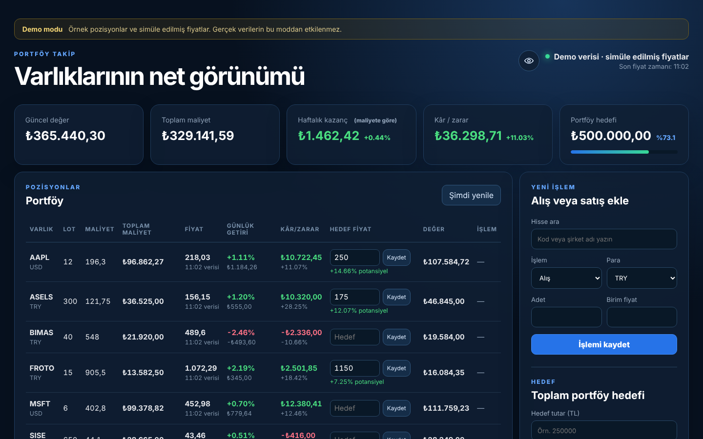
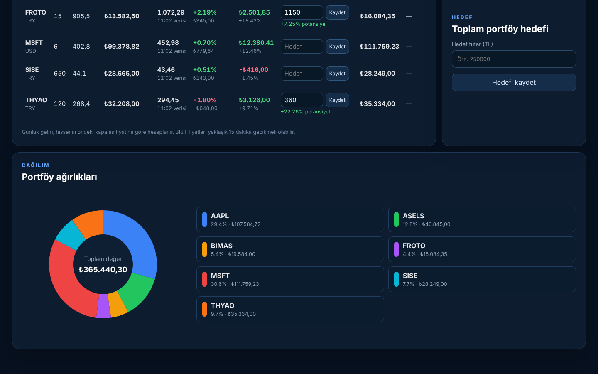

# Portföy Takip — Stock Portfolio Tracker

A personal stock portfolio tracker for Borsa Istanbul and US stocks, built with
classic **Java EE: JSP, Servlets and an embedded H2 database**. Prices come from
Yahoo Finance and refresh every five minutes; everything is shown in Turkish lira.

The interface is in Turkish.



## Features

- Buy and sell stocks; lots and weighted average cost update automatically
- Live price, daily change and profit/loss per position, converted to TRY
- Weekly gain (last five trading days) relative to cost
- Target price per stock with remaining upside, plus a target for the whole portfolio
- Allocation donut chart
- Stock search by ticker or company name, with keyboard navigation
- Privacy mode: one click masks every amount on screen
- Offline **demo mode** with sample positions and simulated prices
- Responsive layout for phone and desktop



## Run it

Requires Java 17+ and Maven 3.9+.

```sh
mvn clean package cargo:run          # real prices (needs internet)
mvn clean package cargo:run -Pdemo   # demo: sample data, no internet needed
```

Then open http://localhost:8080/portfoy/.

`target/portfoy-takip.war` can also be deployed to any Tomcat 10.1+ server.

### Settings

| Setting | System property | Environment variable | Default |
| --- | --- | --- | --- |
| Demo mode | `portfoy.demo` | `PORTFOY_DEMO` | `false` |
| Data folder | `portfoy.dataDir` | `PORTFOY_DATA_DIR` | `~/.portfoy-takip` (demo: `~/.portfoy-takip-demo`) |

Demo mode uses its own data folder, so it never touches real positions.

### Windows shortcuts

`scripts/windows/` contains one-click launchers: `Portfoy.vbs` starts the server
hidden and opens the app in a Chrome/Edge app window (closing the window stops the
server), `Demo_Portfoy.cmd` starts the demo. Maven must be on `PATH` or in `MAVEN_HOME`.

## How it works

```text
Browser ──► Servlet ──► PortfolioService ──► PortfolioRepository ──► H2
   ▲           │               │
   │           ▼               └──► PriceProvider (Yahoo Finance or demo)
   └──────── JSP / JSON
```

| Layer | Classes | Responsibility |
| --- | --- | --- |
| Web | `DashboardServlet`, `PortfolioApiServlet`, `TradeServlet`, `TargetsServlet`, `DeletePositionServlet`, `SymbolSearchServlet` | HTTP in/out, same-origin check on POSTs |
| View | `dashboard.jsp`, `app.js` | Page skeleton; the table and chart refresh from `/api/portfolio` |
| Service | `PortfolioService` | Validation, profit/loss maths, currency conversion |
| Prices | `YahooPriceService`, `DemoPriceService` | Quotes with a 50-second cache; last good quote on failure |
| Data | `PortfolioRepository` | All SQL; positions and settings in H2 |

Some details worth noting:

- **Previous close** comes from the second-to-last daily candle, not Yahoo's
  `chartPreviousClose` (which is the close before the whole requested range).
- If the USD/TRY rate can't be fetched, USD positions are left out of the totals with a
  warning instead of being silently valued at a rate of 1.
- Amounts are validated as finite, positive numbers (`NaN`/`Infinity` are rejected);
  a comma is accepted as the decimal separator.

## Tests

```sh
mvn test
```

Unit tests cover quote parsing, average cost, profit and daily/weekly change,
USD conversion, selling rules and input validation.

> Prices from free sources can be delayed by about 15 minutes. This is a tracking tool,
> not a trading platform.
